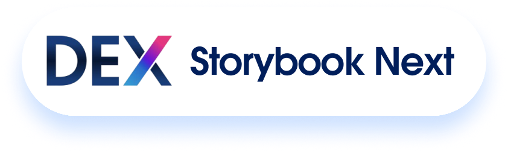

> **⚠️ This repository has moved.**
>
> DEX Storybook Next is now actively maintained at **[salesforce-ux-emu/dex-storybook-next](https://github.com/salesforce-ux-emu/dex-storybook-next)**. Please use that repo for the latest updates, new issues, and pull requests.
>
> This SF-BT-NonProd copy is kept only as a historical/archive reference and is no longer updated.
>
> **Why the move?** The `salesforce-ux-emu` org supports self-service repo creation, forking, and GitHub Pages, making it easier for anyone to fork this workbench and deploy their own live version.

# DEX Storybook Next

A **component workbench for Salesforce Lightning** — build, preview, document, and push components across code, browser, and Figma.

Ask Claude to create a component and it shows up in three places:

1. **Storybook** — isolated catalog with docs, controls, and a 3-theme switcher (SLDS2 Cosmos, SLDS1, WES)
2. **Shell App** — a running Salesforce-like application with routing and navigation
3. **Figma** (optional) — real SLDS 2 library instances via the integrated mockups skill

All three share the same source. Change the component once, see it everywhere.

---

## Quick Start

```bash
nvm use              # Node 20
npm install
npm run storybook    # Component catalog → http://localhost:6006
npm run dev          # App shell → http://localhost:3000
```

---

## What You Get

| Output | Command | What it shows |
|--------|---------|---------------|
| Component catalog | `npm run storybook` | Every component in isolation — swap themes, tweak props, read docs |
| Running app | `npm run dev` | Components mounted in a full Lightning-style app with tabs and routing |
| Figma mockup | `/slds-figma-mockups` | High-fidelity SLDS 2 representation using real Figma library components |

---

## Creating Components

Just ask Claude. It handles everything:

- Scaffolds the component (markup, logic, styles, stories, docs)
- Registers it in Storybook and the Shell App
- Enforces SLDS styling rules and accessibility patterns
- Optionally pushes it to Figma

No manual file creation, no boilerplate, no forgetting to register.

---

## Three Design System Themes

Every component renders under all three themes — switchable from the Storybook toolbar or Shell App:

| Theme | Design system |
|-------|---------------|
| **SLDS2 - Cosmos** | Salesforce Design System 2 (default) |
| **SLDS1 - Lightning Blue** | Classic Salesforce Lightning |
| **WES** | Web Experience Standard (Experience Cloud) |

Components use SLDS tokens for all visual values — colors, spacing, typography adapt automatically.

---

## Integrated Skills

### SLDS Figma Mockups

Build Salesforce page mockups in Figma using real SLDS 2 component instances, tokens, and page blueprints. Supports Account, Opportunity, Quote, Case, Asset layouts (or custom).

```
/slds-figma-mockups
```

Requires Figma MCP authentication. Created by Pascal Mercier (pmercier@salesforce.com).
Source: [`slds-figma-mockups-skill`](https://github.com/salesforce-ux-emu/slds-figma-mockups-skill)

### UI Health Check & Fix

Audit components across 8 dimensions (accessibility, performance, SLDS compliance, security, and more). Auto-apply fixes with confidence scoring and rollback.

```
/ui-health-check
/ui-health-fix --preview
```

Created by Damilare Olowoniyi (dolowoniyi@salesforce.com).
Source: [`lwc-storybook/healthchecks`](https://github.com/SF-BT-NonProd/lwc-storybook/tree/healthchecks)

---

## Learn More

| Audience | Document |
|----------|----------|
| Developers | [DEVELOPERS.md](DEVELOPERS.md) — architecture, scripts, routing, config, troubleshooting |
| Designers | [DESIGNERS.md](DESIGNERS.md) — themes, tokens, component exploration, Figma workflow |

---

## Key Tech

LWC 9 / Vite / Storybook 10 / lightning-base-components / SLDS 2 / WES / Synthetic Shadow DOM

Extends the official [design-system-2-starter-kit](https://github.com/salesforce-ux/design-system-2-starter-kit) with AI-enforced compliance, Figma integration, health checks, 3-theme support, and component documentation.

---

## Prerequisites

- **Node.js 20** — `nvm use`
- **npm**
